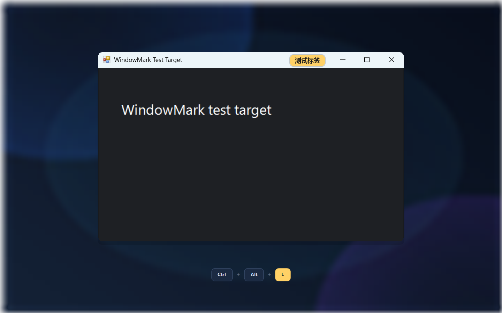

# 窗签 WindowMark

给 Windows 窗口加一张看得见的便利贴，让相似的窗口一眼就能区分。

[English](README.en.md) | 简体中文



同时开着多个聊天窗口、编辑器或终端时，它们往往长得几乎一样，切换前总要靠猜。WindowMark 可以为任意窗口叠加一个自定义标签，并且**只在屏幕上显示**：窗口原本的标题、任务栏和 Alt+Tab 条目都不会被修改。

## 功能

- **覆盖式标签**：在窗口标题栏右上角绘制彩色标签，不改变窗口本身。
- **快捷键标记**：按 `Ctrl + Alt + L`，为鼠标指向的窗口打开标签编辑器。
- **托盘入口**：也可以右键托盘图标，从“选择窗口打标签”的列表中选择。
- **自定义外观**：最多 24 个字符，内置 8 种颜色，支持中文等 Unicode 文本。
- **点击穿透**：标签不拦截鼠标、不抢焦点，也不出现在任务栏和 Alt+Tab 中。
- **自动跟随**：窗口移动、缩放时标签同步移动；窗口最小化或切换到其他虚拟桌面时隐藏，窗口关闭后自动清理。
- **持久化规则**：按“可执行文件 + 窗口类 + 原生标题”保存规则，重启 WindowMark 或再次打开相同窗口时自动恢复标签。
- **高 DPI 感知**：Per-Monitor V2，在 150% 缩放下位置正确。
- **本地优先**：数据仅保存在本机 JSON 文件中，无网络请求、无遥测。

> 当前为 `0.1.0` 早期版本，界面为简体中文。

## 系统要求

- Windows 10 / Windows 11，x64（在 Windows 11 + 150% 缩放下实测通过）
- 运行：.NET 8 Desktop Runtime (x64)
- 构建：.NET 8 SDK

## 构建与运行

```powershell
dotnet build WindowMark.csproj -c Release
dotnet run --project WindowMark.csproj
```

构建完成后也可以直接启动：

```powershell
.\bin\Release\net8.0-windows\WindowMark.exe
```

可选：生成框架依赖的单文件版本（目标机器需安装 .NET 8 Desktop Runtime）：

```powershell
dotnet publish WindowMark.csproj -c Release -r win-x64 --self-contained false -p:PublishSingleFile=true
```

## 使用

1. 启动 WindowMark，托盘区域会出现一个 `W` 图标，程序不显示主窗口。
2. 把鼠标移到目标窗口上，按 `Ctrl + Alt + L`。
3. 输入标签文字、选择颜色，按“保存”。
4. 对同一窗口再次按快捷键，可以修改或删除标签。
5. 如果快捷键被其他程序占用，右键托盘图标，使用“选择窗口打标签”。
6. 退出程序：右键托盘图标，选择“退出”。

窗口最小化后标签会自动隐藏，恢复窗口后重新出现。

## 数据与隐私

| 文件 | 内容 |
| --- | --- |
| `%APPDATA%\WindowMark\labels.json` | 标签规则 |
| `%APPDATA%\WindowMark\log.txt` | 诊断日志 |

所有数据只保存在本机，程序不发起网络请求。可以从托盘菜单打开标签数据文件夹。

## 已知限制

- 标签固定绘制在窗口标题栏右上角，适配常规标题栏；使用沉浸式自绘标题栏的应用（部分 Electron / WinUI 应用、游戏）可能位置不理想。
- 规则匹配包含窗口的原生标题。浏览器标签页、包含文件名的编辑器、显示当前目录的终端等标题经常变化的窗口，重新打开后可能无法自动匹配，需要重新打标签。
- 以管理员权限运行的窗口可能无法显示标签（受 Windows UIPI 限制）。
- 标签只针对常规顶层窗口；桌面、任务栏、工具窗口等会被忽略。
- 暂无安装程序、自动更新和开机启动功能。

## 实现概述

WindowMark 是一个 .NET 8 WPF 应用，没有主窗口，只包含托盘图标、标签编辑器和一个覆盖层：

- 通过 Win32 API 枚举顶层窗口，使用 DWM 的 `DWMWA_EXTENDED_FRAME_BOUNDS` 获取真实边框。
- 标签是带有 `WS_EX_LAYERED | WS_EX_TRANSPARENT | WS_EX_NOACTIVATE | WS_EX_TOOLWINDOW` 的无边框窗口，点击可穿透，并置于目标窗口正上方。
- 以约 30 FPS 同步标签位置，每秒扫描一次窗口变化，处理新窗口、关闭和最小化。
- 标签规则保存在 `%APPDATA%\WindowMark\labels.json`。
- 应用声明 Per-Monitor V2 DPI 感知，并通过单实例互斥量避免重复启动。

### 目录结构

```text
WindowMark/
├─ Core/
│  ├─ AppController.cs      # 启动、快捷键与编辑流程
│  ├─ OverlayManager.cs     # 覆盖层生命周期与窗口跟踪
│  ├─ WindowService.cs      # 窗口枚举、识别与过滤
│  ├─ LabelStore.cs         # 标签规则持久化
│  ├─ TrayController.cs     # 托盘图标与菜单
│  └─ HotkeyWindow.cs       # 全局热键
├─ UI/
│  ├─ OverlayWindow.xaml    # 标签覆盖层
│  ├─ LabelEditorWindow.xaml# 标签编辑器
│  └─ Palette.cs            # 配色与对比色
├─ Native/NativeMethods.cs  # Win32 / DWM P/Invoke
├─ app.manifest
└─ WindowMark.csproj
```

## 参与贡献

欢迎提交 Issue 和 Pull Request。修改后请确认 `dotnet build WindowMark.csproj -c Release` 可以通过；较大的改动建议先开 Issue 讨论。

## 许可证

本项目基于 [MIT License](LICENSE) 开源。
